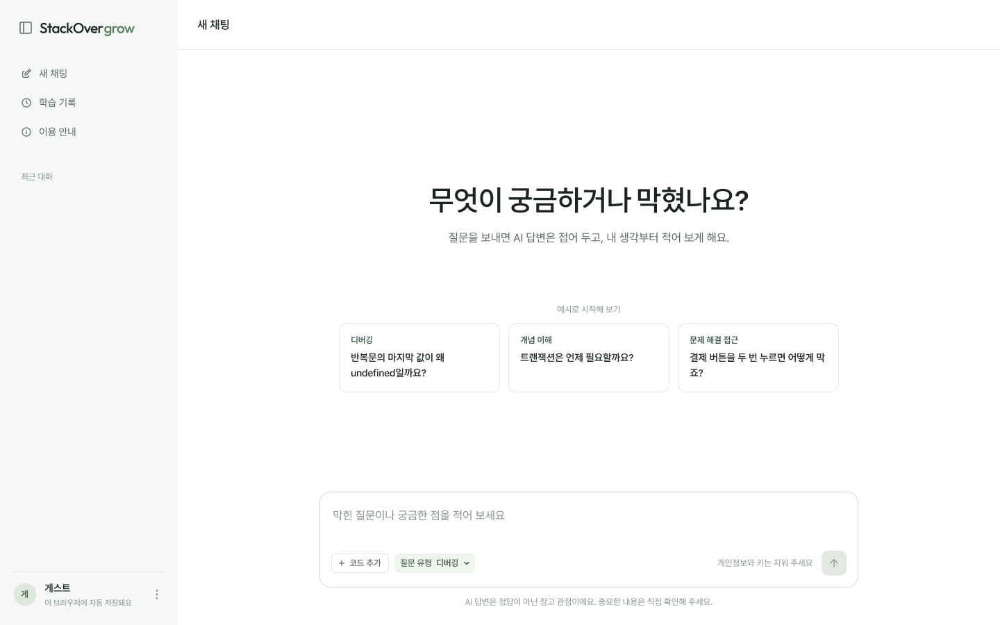
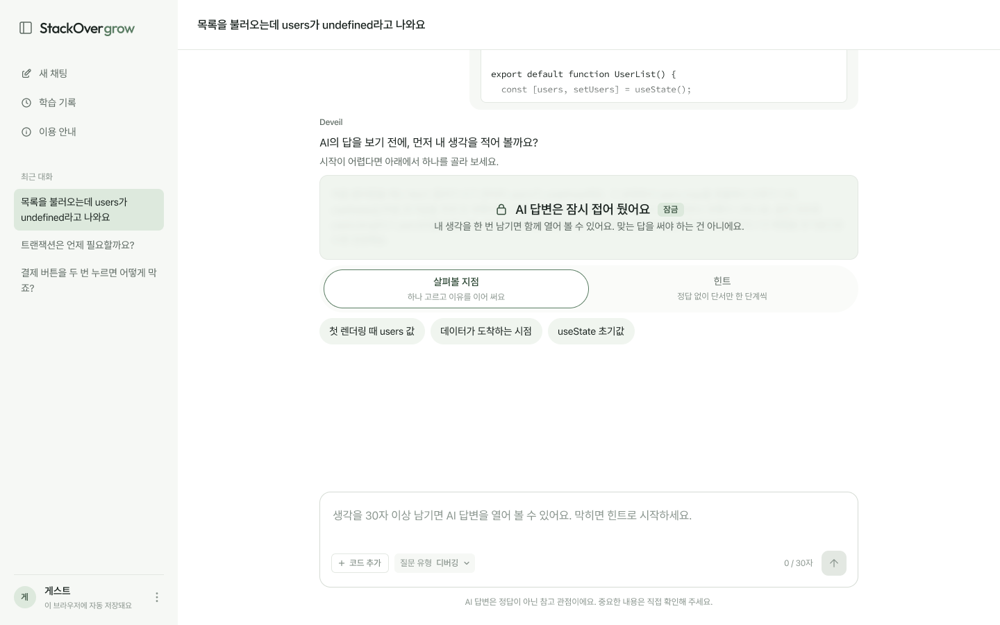
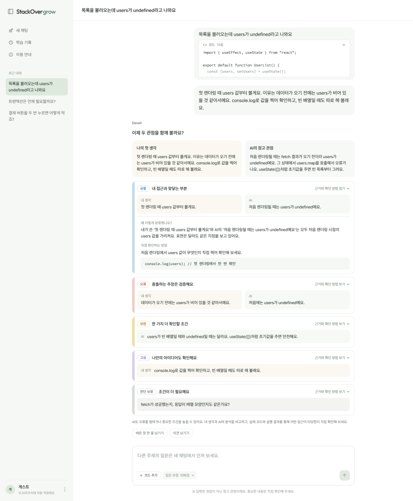
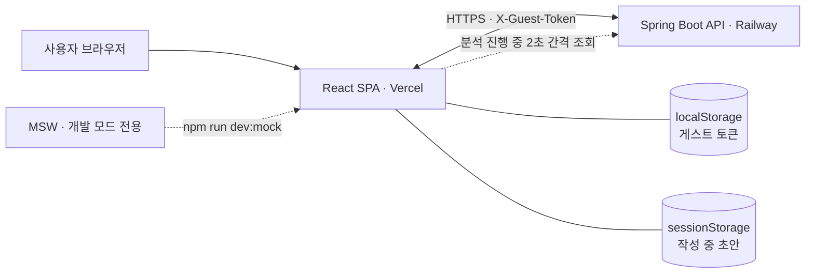

<div align="center">

# StackOverGrow

### AI의 답을 보기 전에, 나의 생각부터.

질문하고 · 생각하고 · 비교하며 배우는 개발 학습 서비스


**1호선톤 6팀 · Frontend Repository**

</div>

---

## About

AI의 설명을 읽으면 이해한 것 같지만, 같은 문제를 혼자 설명하거나 다시 해결하기는 어려울 때가 있습니다.

**StackOverGrow는 답을 확인하기 전에 자신의 예상과 근거를 남기고, AI의 참고 관점과 비교하며 학습하는 서비스입니다.** 개발 질문과 코드를 입력하면 생각을 시작할 관점과 단계별 힌트를 제공합니다. 이후 내 생각을 비교하거나, 기초 설명과 예시부터 학습하는 경로를 선택할 수 있습니다.

이 저장소는 PC 웹 화면을 담당합니다. 질문 입력, 답변 잠금과 생각 작성, 힌트, 비교 결과·기초 학습 화면, 학습 기록과 데이터 삭제를 구현하고 [백엔드 API](https://github.com/line1thonsix/line1thon_6_BE)와 연동합니다.

## Demo

[StackOverGrow 서비스 바로가기](https://stackovergrow.vercel.app/)

## Screenshots

### 01. 질문으로 시작하기

질문 유형을 선택하고 궁금한 내용과 코드를 입력합니다.



### 02. 답을 보기 전에 내 생각 남기기

AI 답변은 잠시 접어 두고, 살펴볼 지점이나 힌트를 참고해 먼저 생각을 적습니다.



### 03. 두 관점 비교하기

내 생각과 AI의 참고 관점을 나란히 보고, 비교 카드의 근거와 확인 방법을 살펴봅니다.



## Key Features

| 기능 | 화면에서 하는 일 |
| --- | --- |
| **질문 입력** | 질문 유형을 고르고 질문(최대 2,000자)과 코드(최대 6,000자)를 입력합니다. Enter 전송, Shift+Enter 줄바꿈을 지원하고 한글 조합 중에는 전송하지 않습니다. |
| **비밀값 마스킹** | API 키, JWT, 개인키, 비밀번호 대입 같은 알려진 패턴을 저장·전송 전에 `[REDACTED]`로 바꾸고 알림을 표시합니다. |
| **답변 잠금과 생각 작성** | AI 답변을 잠근 채 질문에 따라 ‘살펴볼 지점’ 칩을 1~3개 제공합니다. 자동 삽입 문구를 제외한 직접 작성분은 앞뒤 공백을 빼고 30자 이상이어야 하며, 공백을 제외한 서로 다른 문자가 8종 이상 포함되어야 합니다. 자동 삽입 문구를 포함한 전체 제출 내용은 앞뒤 공백을 빼고 최대 2,000자입니다. |
| **단계별 힌트** | 힌트를 1·2단계로 차례로 확인할 수 있습니다. 2단계 힌트 이후에는 조건에 따라 기초 학습으로 전환할 수 있습니다. |
| **비교 결과** | 분석 진행 상태를 표시하고, 완료되면 내 생각과 AI 관점, 분류별 비교 카드를 보여줍니다. 실패하면 남은 횟수 안에서 재시도합니다. |
| **기초 학습** | 핵심 요약, 작은 예시 코드, 관찰·변경 활동을 단계별로 보여줍니다. |
| **학습 기록과 삭제** | 사이드바의 최근 대화와 학습 기록 화면에서 이전 대화를 다시 열고, 대화별 또는 전체 삭제를 할 수 있습니다. |
| **새로고침 복구** | 작성 중인 질문과 생각 초안, 열린 힌트, 진행 중인 분석을 새로고침 후에도 이어서 보여줍니다. |

> AI의 답변과 분류는 정답이 아닌 참고 관점입니다. 중요한 내용은 코드 실행과 추가 확인을 통해 검증합니다.

## Tech Stack

| 구분 | 기술 | 사용 목적 |
| --- | --- | --- |
| UI | **React 19** | 화면 구성과 상태 관리 |
| Language | **TypeScript 7.0** | 화면 모델과 API 응답 타입 검사 |
| Build | **Vite 8** | 개발 서버, 프로덕션 빌드 |
| Styling | **Tailwind CSS 4** | 디자인 토큰 기반 스타일 (PC 1440×900 기준) |
| Routing | **React Router 8** | 페이지 라우팅 |
| Server State | **TanStack Query 5** | 앱 전역 QueryClient 구성 |
| API Mock | **MSW 3** | 백엔드 없이 화면 흐름을 시연·검증하는 개발용 가상 서버 |
| Lint & Test | **oxlint · Node.js test runner** | 정적 검사, 흐름별 단위·통합 테스트 |
| Hosting | **Vercel** | 프론트엔드 배포 |

## System Architecture



- 첫 요청 때 `POST /api/sessions`로 게스트 토큰을 발급받아 `X-Guest-Token` 헤더로 보냅니다. 토큰이 만료되면 새로 발급하고, 이전 게스트의 대화는 새 토큰으로 다시 요청하지 않습니다.
- 생각 제출과 기초 학습 선택 뒤에는 분석 상태를 2초 간격으로 조회합니다. 결과는 작업 완료와 서버의 잠금 해제가 함께 확인된 뒤에 표시합니다.
- 잠금 상태의 응답에는 기준 답변과 분석 결과가 없으며, 화면 상태로 옮길 때도 공개 가능한 필드만 복사합니다.

## Getting Started

```sh
git clone https://github.com/line1thonsix/line1thon_6_FE.git
cd line1thon_6_FE/frontend
npm install
```

### 백엔드 연동 모드

`.env.example`을 `.env.local`로 복사해 실행합니다.

```sh
cp .env.example .env.local
npm run dev -- --host localhost --port 5173 --strictPort
```

| 환경 변수 | 설명 |
| --- | --- |
| `VITE_API_BASE_URL` | 백엔드 API 주소. `/api`까지 포함합니다. |
| `VITE_ENABLE_MOCKS` | `false`로 둡니다. |

백엔드 CORS에는 `http://localhost:5173`, `http://localhost:3000`이 등록돼 있습니다. `VITE_` 환경 변수는 번들에 포함되므로 비밀값을 넣지 않습니다.

### Mock 모드

백엔드 없이 MSW 가상 서버로 전체 흐름을 체험합니다. 개발 모드에서만 동작하며 프로덕션 빌드에는 포함되지 않습니다.

```sh
npm run dev:mock
```

URL 매개변수로 실패·지연 상황을 재현할 수 있습니다. 예: `/?analysis=fail-once`, `/?mock=slow`. 전체 옵션은 [frontend/README.md](frontend/README.md)에 정리했습니다.

### 빌드와 검사

```sh
npm run build     # TypeScript 검사 + 프로덕션 빌드
npm run lint
npm test
npm run preview
```

## Project Structure

```text
line1thon_6_FE/
├── assets/readme/                  # README 화면 이미지
└── frontend/
    ├── public/                     # MSW 서비스 워커
    ├── src/
    │   ├── pages/                  # 홈 · 이용 안내 · 404
    │   ├── components/
    │   │   ├── chat/               # 질문 입력 · 잠금 · 힌트 · 생각 작성 · 비교 결과 · 기초 학습
    │   │   ├── history/            # 학습 기록
    │   │   ├── layout/             # 앱 레이아웃 · 사이드바 · 헤더 · 게스트 메뉴 · 삭제 확인
    │   │   └── ui/                 # 버튼 · 카드 · 입력 · 아이콘
    │   ├── api/
    │   │   ├── backend/            # 백엔드 클라이언트 · 게스트 토큰 · 응답 검증 · 잠금 상태
    │   │   └── *.ts                # 화면별 API 어댑터와 상태 변환
    │   ├── hooks/                  # 질문 · 힌트 · 생각 제출 · 분석 · 기록 흐름
    │   ├── mocks/                  # 개발용 MSW 핸들러와 fixture
    │   ├── security/               # 비밀값 마스킹
    │   ├── storage/                # 브라우저 저장소 · 복구
    │   ├── styles/                 # 디자인 토큰
    │   └── types/                  # 화면 모델 타입
    ├── tests/                      # 흐름별 테스트
    └── README.md                   # 개발 메모 · Mock 시나리오 · 기능별 검증 절차
```

## Documentation

- [개발 메모와 Mock 시나리오](frontend/README.md)
- [백엔드 저장소](https://github.com/line1thonsix/line1thon_6_BE) · [Swagger UI](https://line1thon6be-production.up.railway.app/swagger-ui/index.html)

## Team

**1호선톤 6팀**

| 이름 | 역할 |
| --- | --- |
| [최지원](https://github.com/jiwonch01) | Frontend |
| [김다은](https://github.com/nutdaeun) | Backend |
| [문효재](https://github.com/hyojae02) | Backend |
| [이유주](https://github.com/dailyhm) | AI |
